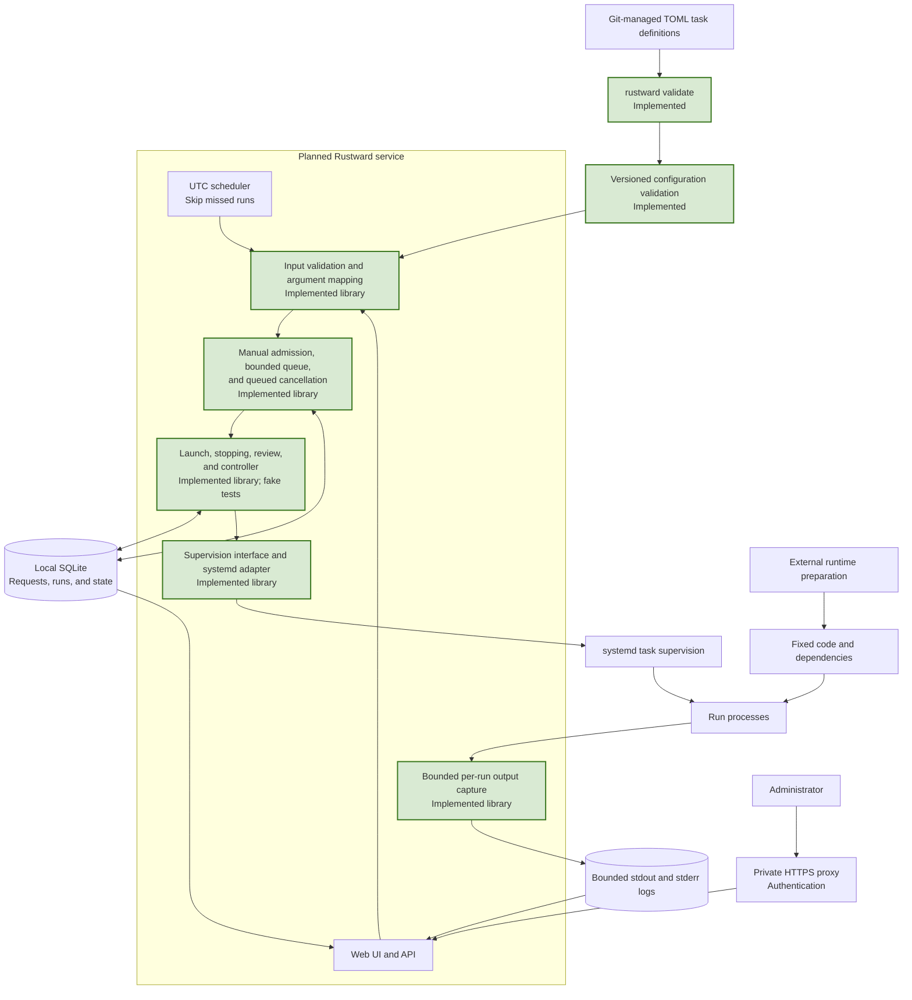

# Rustward architecture

Rustward will run generic command tasks for one trusted administrator. Version 2
configuration validation, request input validation, argument generation, and
manual admission, dispatch, stopping, review, and the [execution controller](temporary/controller.md)
are implemented as libraries. Tests use fake supervision; real-host acceptance
and the service loop remain gated. Green marks implemented parts.

Follow [Gravity](GRAVITY.md). Unaccepted mechanisms in [requirements](temporary/requirements.md)
remain proposals. This diagram does not authorize execution, migration, or deployment.

## System diagram



The service boundary shows the planned single Rust service. The proxy, systemd,
task processes, and runtime preparation are outside that service. The local
SQLite database and log files store retained state and output. Per-run output
capture supplies descriptors through the controller; the service loop remains future work.

## Current implementation

`rustward validate <rustward.toml>` validates version 2 service settings and nested
task and schedule files. Cron uses a strict subset and `croner`.
Paths supply IDs; Linux `openat2` rejects symlinks.
See the [loading contract](temporary/configuration.md).

`config::load(path)` returns a complete `Config` or an error. Roots must exist;
relative paths use the service file's directory. Bounded loading requires
unchanged files; two matching reads are not an atomic snapshot.

`Config::arguments` validates values, applies defaults, and returns separate
arguments. Values use `BTreeMap<String, toml::Value>`. Accessors expose read-only
settings, task IDs, and schedules. Runtime setting integration remains deferred.

Activation, reload, scheduling, and the service execution loop remain unimplemented. TOML owns
definitions; SQLite owns runtime state. Definition moves change IDs; root moves
do not. Admitted runs retain their snapshots and IDs.

Copied Docker evidence passes A01/A02. [A03](temporary/ssh-acceptance.md) failed;
its fix needs a rerun. [Telemetry](temporary/telemetry.md) remains unimplemented.

## Design boundaries

[Gravity](GRAVITY.md) owns the accepted architecture rules. The service handles
admission, dispatch, scheduling, and retained state. The proxy authenticates the
administrator; systemd supervises run processes. Runtime preparation and
production deployment remain outside the service.

Runs retain their selected prepared runtime and use separate writable
directories. Local cleanup is not proof of external completion. Recovery and
storage failures can block new starts; see the [execution
contracts](temporary/execution.md#admission-contract-decisions).

State and logs have configurable resource bounds, with one explicit exception:
compact admitted manual-request records remain indefinitely without a fixed
storage ceiling. Review logs can also prevent dispatch when protected data fills
the log allowance. See P07 and the retention contract for the exact rules.

## Implementation gates

The [implementation
handoff](temporary/implementation.md#remaining-specifications-and-evidence) owns the
remaining evidence: isolated-host recovery, permissions and log bounds, scheduling
checkpoints, retention, and restore. Proxy access and secrets need specifications.

The current tests cover configuration, argument generation, manual admission,
queued cancellation, migration, supervision, and controller coordination.
Synthetic adapter and private D-Bus tests do not prove
execution, recovery, scheduling, or deployment behavior. License selection is a
release gate; workload compatibility and production migration require separate
review and authorization.

## Manual admission library

This library implements manual admission and queued cancellation; dispatch has
a separate session interface below.
The caller selects an opaque prepared runtime identity; admission retains it but
does not verify runtime files. [Prepared verification](temporary/runtime.md) is
a separate dispatch gate. Runtime preparation, restore procedures, and
execution integration remain gated by their accepted contracts.

### Storage and transactions

`admission::Store::open` opens a dedicated local SQLite database. Empty paths, `:memory:`, and SQLite URI handling are excluded. Schema version
7 uses rollback journaling and `synchronous=FULL`. An immediate transaction
serializes request lookup, queue capacity checks, and insertion of both a queued
run and its permanent admission record. A response is returned only after commit.
Run IDs are random 256-bit hexadecimal strings. Queue order is the insertion
sequence. The default capacity is 100; limits are stored in the database and can
be changed through `set_queue_limit`. Lowering the limit preserves existing runs.

Queued runs retain the normalized task snapshot, configuration revision,
generated arguments, submitted inputs, and runtime identity. Schema defaults
are applied before serialization. JSON object keys are sorted; ordered lists
and scalar types are preserved. Task snapshot bytes and the
`rustward-definition-v1` SHA-256 prefix remain unchanged.

New configuration revisions hash `rustward-configuration-v2` and sorted-key JSON
with `version: 2`, tasks and schedules sorted by derived ID. Service settings
and root paths are excluded. Task revisions include the task ID. Stored revisions
retain their meaning and bytes; no database migration or history rewrite is made.
See [compatibility](temporary/configuration.md#format-change-and-compatibility).

Storage errors close the affected store handle. The service must close all
admission and dispatch paths on such an error under P06. The controller connects
the shared Safety gate and emergency stopping; a service loop remains future work. Lock contention returns a separate
busy response after a five-second wait. Reopening a failed handle is an explicit
caller action, not automatic recovery. Use a protected database directory: issuer
secrets and non-secret submitted inputs are stored there. No rejection history
is stored. Diagnostics use fixed messages and omit payloads and SQLite details.

### Request identity

Keys are lowercase hex encodings of 97 bytes: format byte 1, 32-byte generation,
32-byte random nonce, and 32-byte HMAC-SHA-256 over the preceding bytes. Each
installation database retains its random generation and 32-byte signing secret.
Issuance writes no key record and reserves no capacity. OS randomness supplies
secrets, generations, nonces, and run IDs. HMAC verification uses the library's
constant-time verification. Known admitted keys are looked up before current
issuer verification, allowing future restore generations to retain known keys.
There is no restore command in this slice.

Request fingerprint version 1 hashes `rustward-request-v1`, then length-prefixed
UTF-8 task ID, input count, and entries sorted by input ID. Lengths and counts
are unsigned 64-bit big-endian values. Each entry contains a length-prefixed ID,
then a type byte (`s`, `i`, or `b`) and value. Strings use length-prefixed UTF-8;
integers use signed 64-bit big-endian bytes; booleans use byte 0 or 1. Defaults
are excluded. Unsupported scalar types and composite values are rejected.
An omitted value thus differs from an explicit default.

A matching admitted key returns the original run ID before consulting the
current task, runtime selection, admission control, or queue capacity. A changed
payload is rejected. A missing history row returns `HistoryRemoved`; it does not
create a run. Records are not expired. History deletion is not exposed here. Dispatch transitions are described below; retention must preserve queued runs.

Requests are limited to 256 inputs and 64 KiB of canonical request bytes; runtime
identities are nonempty and at most 1024 bytes. Task snapshots and generated
arguments together are limited to 1 MiB per admission. These are implementation
bounds for this library, not transport or global metadata limits. Admission can
be closed independently through a stored control. No active processes exist in
this slice.

### Admission evidence and remaining gates

Tests cover independent connections with concurrent matching retries and queue
capacity races, payload conflicts, rejected-request correction, immutable
snapshots, retry after task removal, missing history, and issuer changes. A
trigger failure on the second write proves rollback of the first write. A child
process exits with an unfinished equivalent first-write transaction to check
SQLite recovery. These tests do not simulate host power loss or prove filesystem
and hardware durability. Storage diagnostics and request-size limits are tested.

Full restore, retention cleanup, real-host acceptance, and service integration
remain unimplemented. Tests do not execute real tasks.

## Queued cancellation library

`admission::Store::cancel_queued(run_id)` completes a queued run with the result
`Cancellation`. It does not start a process or perform local process cleanup:
this run has never dispatched. The method works while admission is closed.
`Cancellation::Cancelled` is returned only after the transaction commits.
A repeated cancellation returns `AlreadyCancelled` without changing the record.
A missing run returns `NotFound`, including when only its permanent admission
record remains. A dispatched run returns `NotQueued`. No history is recreated.

Cancellation uses an immediate transaction to read the run state and update
phase and result together. Admission uses the same SQLite write lock. Queue
capacity counts only queued rows, so a committed cancellation releases capacity
without deleting history. Competing cancellations produce one change. A
concurrent admission sees capacity before or after the committed cancellation;
a queue-full response can be retried with its unbound key. A failed transaction
leaves the run queued and uses the existing storage-error handling.

`Store::run_state(run_id)` returns separate phase and result fields. Invalid
stored combinations close the handle with a storage error. Schema version 7 adds
controller output/setup evidence to [review](temporary/review.md).

Migration from versions 1–6 preserves run data, results, issuer state,
admission records, revisions, and sequence high-water marks. Version 1 first gains
the version 2 cancellation model. All steps commit together. Failed migrations
roll back; older binaries reject version 7. Tests retain SQL fixtures and
check failed table replacement, preserved identities, and sequence order.

## Durable dispatch library

`dispatch::Session::open(path, limits)` holds an exclusive OS lock on the database
inode and recovers unfinished dispatched runs. Admission connections remain
independent. Keep the protected database inode in place. Defaults are one active
run, 10 MiB per-run log allowance, and 1 GiB aggregate accounting capacity.

Dispatch starts paused. `claim_next` atomically selects the oldest queued run,
reserves capacity, records launch intent, and returns a one-use permit containing
retained launch data. `start` consumes it and calls a supplied supervisor once.
No database transaction spans that call. Tests supply a fake; there is no service
loop or systemd integration. `observe` retains identity, exit, cleanup, and review
evidence. `finish` requires cleanup and caller-confirmed synchronized output.

A new session never reconstructs permits. Unfinished launches become CleaningUp
with Interruption unless a result was already decided. Uncertainty blocks new
starts; missing units do not prove cleanup. Review remains required after
completion and reopen until explicit [acknowledgement](temporary/review.md). Slots and log
accounting remain reserved through uncertainty; completed logs still count.
No retention reclamation is provided. See the [dispatch contract](temporary/dispatch.md)
for APIs, failure cases, compatibility, and remaining integration gates.

## Supervision interface and systemd adapter

The user selected a dedicated unprivileged systemd user manager and supplied
Debian 13 as the fleet baseline. The adapter targets systemd 257 or newer and
cgroup v2 on that host. It does not request system-manager or privileged unit
creation. Host setup must keep the dedicated user manager available. The
adapter process and manager must see the same cgroup hierarchy. Production host
setup remains in the deployment repository; nothing here authorizes deployment.

`supervision::Supervisor` defines start, observation, stop, and reference release.
Tests and future execution-core tests can replace the complete supervisor.
`systemd::Systemd<M, C>` implements this interface. Its `Manager` and `Cgroups`
ports permit controlled manager replies and cgroup evidence. `UserBus` implements
the manager port with zbus blocking D-Bus calls on the session bus, with no
system-bus fallback. Configure that session as the dedicated user's bus. Each
D-Bus method has a five-second timeout. `CgroupFs` reads at most 4096 bytes of
`cgroup.events` under `/sys/fs/cgroup`; malformed or unreadable evidence stays
unknown. No daemon, command wrapper, shell launcher, or database migration is
added by this slice.

### Start and identity

A `Launch` uses an existing 64-character lowercase hexadecimal run ID, absolute
program and working-directory paths, separate arguments, and a cleanup grace
period. `DEFAULT_CLEANUP_GRACE` is 30 seconds; callers can supply another positive
period in whole microseconds. The adapter rejects NUL, more than 65,536 arguments,
and more than 1 MiB of combined program, directory, and argument text.

The unit name is `rustward-run-<run-id>.service`. `StartTransientUnit` uses job
mode `fail`. It never replaces an existing run unit or retries a failed call.
`StartOutcome::Accepted` confirms only that a start job was queued. Explicit
permission/argument errors report `Rejected`; an existing unit reports
`Conflict`. Other errors, including a lost reply, report `Uncertain`. None
permits an automatic new start for the same admitted run.

The adapter sets `Type=exec`, `Restart=no`, `KillMode=control-group`,
`SendSIGKILL=yes`, and the selected stop grace period. `ExecStartEx` includes
`no-env-expand`, preserving complete argument values without shell or environment
expansion. `RemainAfterExit=yes` retains a successful exited service for explicit
cleanup. AddRef pins the unit while its client lives; recovery uses RefUnit
after identity checks. Release needs durable cleanup.
Standard input is null; stdout and stderr use caller-supplied file descriptors.
The `capture` library supplies draining and per-run bounded retention. There is no implicit journal or
file-output fallback. Controlled starts use the pinned environment launcher and
drop privileges; custom environment and secrets remain future work. Legacy
low-level starts do not provide the controller environment.

An observed systemd invocation ID and cgroup path form
`supervision::ExecutionIdentity`. Dispatch retains this
correlation before using it for subsequent observation or stopping. This identity
is separate from the run ID and prepared runtime identity. The adapter checks
unit description, transient status, service type, and any supplied prior
invocation and cgroup. A mismatch prevents stop or release.

### Observation and cleanup

Up to three fresh snapshot pairs surround new cgroup reads. Only matching
snapshots provide evidence. Changed identity, lost reads, or three changed pairs
remain uncertain. A start job, PID, or process timestamp does not prove execution.
Running requires an active, running `Type=exec` unit with a main PID. Exit data
uses the manager's exit timestamp, exit code, and signal status. An exit code is
local evidence only; it does not prove an external outcome.

Cleanup is confirmed only when the unit is inactive or failed, no job is pending,
no main PID is reported, and its matching cgroup is empty or absent. A retained
prior identity permits checking the cgroup after systemd clears its current
cgroup path. Missing units, unknown cgroups, and missing PIDs alone do not prove
cleanup. Stopping is distinct from observing program exit. A graceful stop queues
`StopUnit`; force stopping sends SIGKILL to all unit processes. Neither response
confirms cleanup. `release` checks cleanup before calling `UnrefUnit`; callers
must first durably retain exit and cleanup evidence. Capture EOF and final
completion can follow reference release. Connection loss can
release references, so unit retention alone is not a recovery protocol.

### Evidence and integration gates

`tests/supervision.rs` uses a fake manager and cgroup reader to test uncertain
starts, exact arguments and settings, identity mismatches, changing observations,
exit data, stop requests, and cleanup checks. Private peer-to-peer D-Bus tests
exercise the actual wire signatures and file-descriptor transfer. Filesystem
tests cover malformed, oversized, and missing cgroup evidence. These tests use
synthetic data and need no real manager.

Run the opt-in test only on an isolated Debian 13 host with the dedicated user
manager and unified cgroup hierarchy:

```sh
cargo test --locked --test systemd_host -- --ignored
```

It starts two synthetic shell workloads to check main-process exit, child
cleanup, and concurrent-unit isolation. The normal test run skips it. It has not
been run in this devbox, which has no manager. Private D-Bus tests do not prove
systemd behavior or host permissions.

The [controller](temporary/controller.md) connects pinned runtime/host checks,
manager UID binding, capture, and stopping. An independent worker stops work
on storage faults without a database write or capture join. Completion commits
output evidence and accounting together. Isolated-host acceptance remains required.
Missing units and lost replies cannot cause another start.

The implementation follows the [systemd 257 D-Bus interface](https://www.freedesktop.org/software/systemd/man/257/org.freedesktop.systemd1.html)
and its [transient launch property construction](https://github.com/systemd/systemd/blob/v257/src/run/run.c).


## Bounded output capture

`capture::Capture` retains separate raw streams under one limit (default 10 MiB)
and drains after truncation. Storage faults remain separate from truncation.
See the [capture contract](temporary/capture.md) for descriptor lifecycle,
bounds, synchronized completion, tests, and remaining service integration.
