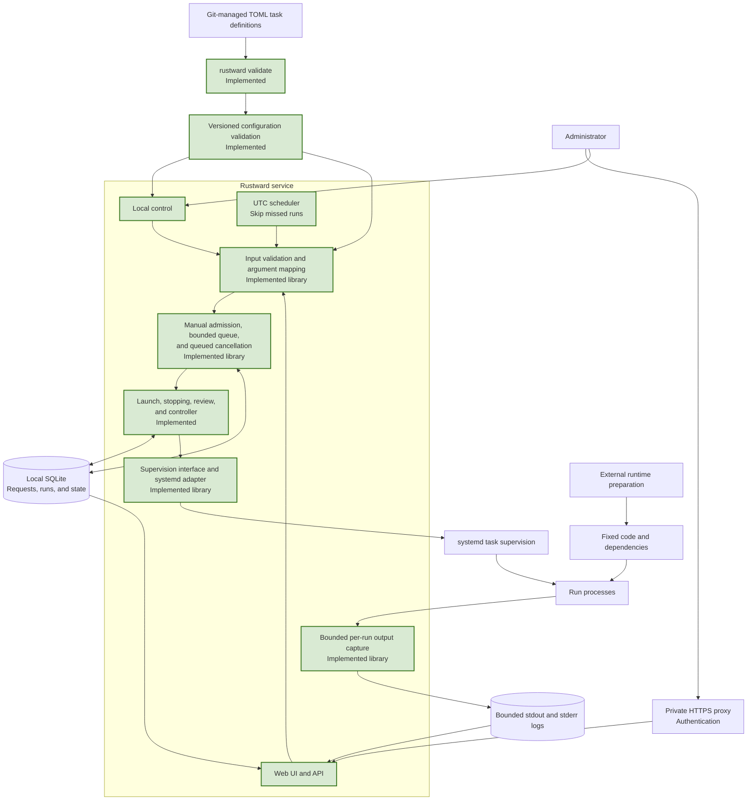

# Rustward architecture

Rustward runs generic commands for one trusted administrator. The local service
implements manual admission, recovery, dispatch, stopping, review, and planned
drain. It also evaluates UTC schedules and supports explicit configuration
reload. The private web console uses the same admission and execution controls.
Vite builds the Svelte console during the Linux Rust build. The Rust service
embeds and serves these assets in the same process.

The service expires eligible completed runs, their logs, and their writable
run directories in bounded batches.
Offline state commands preserve SQLite and retained output in a checked backup.
Restore creates a new state directory and keeps the service closed until the
operator reviews its unfinished runs and releases the restored state.

The service emits structured service logs to standard error for collection by
systemd. The private proxy serves read-only metrics, health, and readiness
from bounded in-process measurements.
[Gravity](GRAVITY.md) owns the accepted constraints and principles.

## System diagram

Green marks implemented components. The proxy, systemd, task processes, and
runtime preparation operate outside the service. The proxy provides private
browser access and authenticates the administrator. The web listener accepts
only the configured proxy UID on a Unix socket. The local control interface
uses the service account. Both paths use the same execution core.

## Definitions and retained state

Git-managed TOML owns service settings and task and schedule definitions. The
path relative to its definition root supplies each task or schedule ID. The
service validates the complete set before activation. SQLite owns admitted
requests, run state, execution identity, and review. The service uses a
separate file store for bounded stdout and stderr.

An admitted run fixes its task definition, generated arguments, and prepared
runtime. Definition changes affect future admissions. Normalize definitions
before computing revisions. Schema defaults participate in the revision, and
formatting does not. Preserve stored revision meanings across changes.
See [configuration ownership](GRAVITY.md#accepted-configuration-ownership-and-identity).

## Request identity

Manual admission commits the request key, queued run, and immutable selection
together before returning success. Request comparison uses the task ID and
typed values supplied before defaults. An admitted key can identify the
original run even after the task changes or its run history expires. A fresh
execution uses a fresh key. Each scheduled occurrence uses the schedule ID
and UTC due time as its identity. See [admission and scheduling](GRAVITY.md#admission-and-scheduling).

## Execution boundary

The controller durably records launch intent before it calls the supervisor.
It reserves an execution slot and log capacity through launch, execution, and
cleanup. Admission and dispatch remain separate controls. Recovery does not
repeat a start for an unfinished dispatched run.

The systemd adapter uses one transient service and cgroup per run. Release
requires evidence that the unit ended and its local processes are gone.
The service can set a memory limit, task count limit, and CPU quota on each
transient unit.
The adapter binds observations to the systemd invocation ID and cgroup path.
It compares fresh unit snapshots around a cgroup read. If the identity changes
or the evidence stays inconsistent, cleanup remains uncertain. The controller
records cleanup before releasing the unit reference.
Output handling must finish before the service records completion. A storage
fault initiates local stopping without a successful database write.
See [Gravity](GRAVITY.md#rules).

The Linux service and acceptance suite build for x86-64 and ARM64. On macOS,
the configuration validator and shared admission, scheduling, and
configuration tests build without the Linux service.

## Prepared runtimes

External preparation publishes immutable code and dependencies. The service
verifies the selected runtime and pinned host dependencies before launch.
Tasks use their admitted executable and working directory. Each run gets
separate writable data outside the prepared runtime. The execution account
holds no privileges that bypass runtime protection. See [P03](GRAVITY.md#p03-prepare-fixed-runtimes-outside-execution).

## Administrator review and acknowledgement

Local cleanup and the run result describe local execution. An uncertain
external outcome blocks new starts. After local completion, an administrator
can acknowledge one run against its current evidence. Acknowledgement records
the checks, remaining uncertainty, and reason to resume. The run result and
other gates retain their original effect. The service commits the note and the
release of that run’s review block together. Retrying the same acknowledgement
ID with the same evidence and note returns the original record. See [P02](GRAVITY.md#p02-preserve-accepted-work-and-stop-on-uncertainty).
