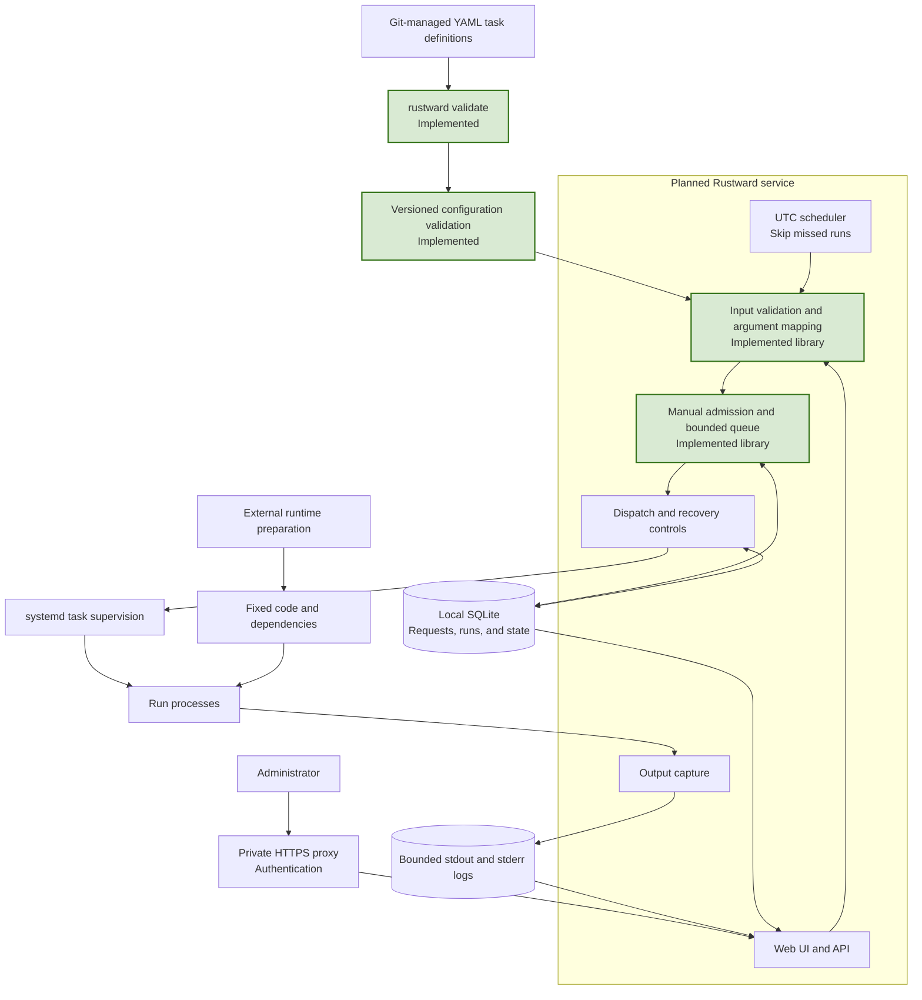

# Rustward architecture

Rustward will run generic command tasks for one trusted administrator. Version 1
configuration validation, request input validation, argument generation, and
durable manual admission are implemented. The diagram shows the planned system and marks the implemented
parts in green.

This overview follows the accepted rules in [docs/GRAVITY.md](GRAVITY.md).
Detailed mechanisms that remain proposals in the [requirements](temporary/requirements.md) remain proposals here. This diagram does not authorize
execution, migration, or deployment.

## System diagram

The service boundary shows the planned single Rust service. The proxy, systemd,
task processes, and runtime preparation are outside that service. The local
SQLite database and log files store retained state and output. Output capture is
a logical component; its systemd interface remains to be defined.

## Current implementation

`rustward validate <config.yaml>` reads one YAML document and checks its
version, task IDs, typed inputs, defaults, choices, and argument references. It
rejects unknown fields and duplicate IDs. It does not execute commands or check
program availability. See the [configuration schema](temporary/configuration.md) and
[synthetic example](../examples/tasks.yaml).

The Rust library exposes `config::validate` and `Config::arguments`. A validated
configuration selects a task by ID, rejects undeclared or invalid values,
applies defaults, and rejects missing required inputs. It returns an ordered
`Vec<String>` with one value per configured argument. It validates unused inputs
too. Internally, `TaskDefinition` contains `InputDeclaration` and
`ArgumentSource` entries. Request input validation resolves typed values without
changing the submitted map. Argument generation converts only referenced values
to strings. Defaults and submitted values use the same type and choice checks.
It does not split, expand, or interpolate values. There is no submission
CLI or command execution. The implemented library is shown inside the planned
service boundary; service integration is future work.

## Design boundaries

[Gravity](GRAVITY.md) owns the accepted architecture rules. The service handles
admission, dispatch, scheduling, and retained state. The proxy authenticates the
administrator; systemd supervises run processes. Runtime preparation and
production deployment remain outside the service.

Runs retain their selected prepared runtime and use separate writable
directories. Local cleanup is not proof of external completion. Recovery and
storage failures can block new starts; see the [execution
contracts](temporary/execution.md#admission-contract-decisions).

State and logs have configurable resource bounds, with one explicit exception:
compact admitted manual-request records remain indefinitely without a fixed
storage ceiling. Review logs can also prevent dispatch when protected data fills
the log allowance. See P07 and the retention contract for the exact rules.

## Implementation gates

The [implementation
handoff](temporary/implementation.md#remaining-specifications-and-evidence) owns the
remaining specifications and required evidence. They include launch recovery, the systemd manager and permissions, output capture,
runtime layout, scheduling checkpoints, retention, and restore mechanisms.
Private proxy access and environment/secret references also need specifications.

The current tests cover configuration, argument generation, and manual admission. They do not prove
execution, recovery, scheduling, or deployment behavior. License selection is a
release gate; workload compatibility and production migration require separate
review and authorization.

## Manual admission library

This slice implements manual admission only. There is no dispatch interface.
The caller selects an opaque prepared runtime identity; admission retains it but
does not verify runtime files. Runtime preparation, restore procedures, and
execution integration remain gated by their accepted contracts.

### Storage and transactions

`admission::Store::open` opens a dedicated local SQLite database. Empty paths, `:memory:`, and SQLite URI handling are excluded. Schema version
1 uses rollback journaling and `synchronous=FULL`. An immediate transaction
serializes request lookup, queue capacity checks, and insertion of both a queued
run and its permanent admission record. A response is returned only after commit.
Run IDs are random 256-bit hexadecimal strings. Queue order is the insertion
sequence. The default capacity is 100; limits are stored in the database and can
be changed through `set_queue_limit`. Lowering the limit preserves existing runs.

Queued runs retain the normalized task snapshot, configuration revision,
generated arguments, submitted inputs, and runtime identity. Schema defaults
are applied before snapshot serialization. JSON object keys are sorted; lists
retain order and values retain type. SHA-256 of the version-prefixed JSON bytes
identifies definition revisions. No schema version 1 YAML fields change.

Storage errors close the affected store handle. The service must close all
admission and dispatch paths on such an error under P06; service integration and
stopping active work are not implemented. Lock contention returns a separate
busy response after a five-second wait. Reopening a failed handle is an explicit
caller action, not automatic recovery. Use a protected database directory: issuer
secrets and non-secret submitted inputs are stored there. No rejection history
is stored. Diagnostics use fixed messages and omit payloads and SQLite details.

### Request identity

Keys are lowercase hex encodings of 97 bytes: format byte 1, 32-byte generation,
32-byte random nonce, and 32-byte HMAC-SHA-256 over the preceding bytes. Each
installation database retains its random generation and 32-byte signing secret.
Issuance writes no key record and reserves no capacity. OS randomness supplies
secrets, generations, nonces, and run IDs. HMAC verification uses the library's
constant-time verification. Known admitted keys are looked up before current
issuer verification, allowing future restore generations to retain known keys.
There is no restore command in this slice.

Request fingerprint version 1 hashes `rustward-request-v1`, then length-prefixed
UTF-8 task ID, input count, and entries sorted by input ID. Lengths and counts
are unsigned 64-bit big-endian values. Each entry contains a length-prefixed ID,
then a type byte (`s`, `i`, or `b`) and value. Strings use length-prefixed UTF-8;
integers use signed 64-bit big-endian bytes; booleans use byte 0 or 1. Defaults
are excluded. Unsupported scalar types and composite values are rejected.
An omitted value thus differs from an explicit default.

A matching admitted key returns the original run ID before consulting the
current task, runtime selection, admission control, or queue capacity. A changed
payload is rejected. A missing history row returns `HistoryRemoved`; it does not
create a run. Records are not expired. History deletion and lifecycle transitions
are not exposed here; future retention must preserve queued runs.

Requests are limited to 256 inputs and 64 KiB of canonical request bytes; runtime
identities are nonempty and at most 1024 bytes. Task snapshots and generated
arguments together are limited to 1 MiB per admission. These are implementation
bounds for this library, not transport or global metadata limits. Admission can
be closed independently through a stored control. No active processes exist in
this slice.

### Admission evidence and remaining gates

Tests cover independent connections with concurrent matching retries and queue
capacity races, payload conflicts, rejected-request correction, immutable
snapshots, retry after task removal, missing history, and issuer changes. A
trigger failure on the second write proves rollback of the first write. A child
process exits with an unfinished equivalent first-write transaction to check
SQLite recovery. These tests do not simulate host power loss or prove filesystem
and hardware durability. Storage diagnostics and request-size limits are tested.

Full restore, history retention, definition migration, prepared runtime
verification, admission/dispatch service integration, and launch recovery remain
unimplemented. The schema currently permits only queued runs. Extend it through
an explicit migration when lifecycle work begins. No run can be executed through
this library.
