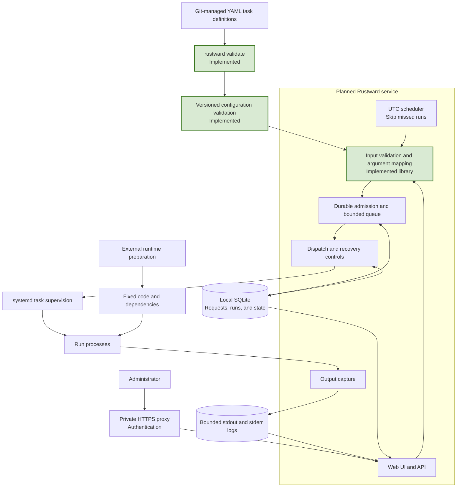

# Rustward architecture

Rustward will run generic command tasks for one trusted administrator. Version 1
configuration validation, request input validation, and argument generation are
implemented. The diagram shows the planned system and marks the implemented
parts in green.

This overview follows the accepted rules in [docs/GRAVITY.md](GRAVITY.md).
Detailed mechanisms that remain proposals in the [requirements](temporary/requirements.md) remain proposals here. This diagram does not authorize
execution, migration, or deployment.

## System diagram

The service boundary shows the planned single Rust service. The proxy, systemd,
task processes, and runtime preparation are outside that service. The local
SQLite database and log files store retained state and output. Output capture is
a logical component; its systemd interface remains to be defined.

## Current implementation

`rustward validate <config.yaml>` reads one YAML document and checks its
version, task IDs, typed inputs, defaults, choices, and argument references. It
rejects unknown fields and duplicate IDs. It does not execute commands or check
program availability. See the [configuration schema](temporary/configuration.md) and
[synthetic example](../examples/tasks.yaml).

The Rust library exposes `config::validate` and `Config::arguments`. A validated
configuration selects a task by ID, rejects undeclared or invalid values,
applies defaults, and rejects missing required inputs. It returns an ordered
`Vec<String>` with one value per configured argument. It validates unused inputs
too. It does not split, expand, or interpolate values. There is no submission
CLI or command execution. The implemented library is shown inside the planned
service boundary; service integration is future work.

## Design boundaries

[Gravity](GRAVITY.md) owns the accepted architecture rules. The service handles
admission, dispatch, scheduling, and retained state. The proxy authenticates the
administrator; systemd supervises run processes. Runtime preparation and
production deployment remain outside the service.

Runs retain their selected prepared runtime and use separate writable
directories. Local cleanup is not proof of external completion. Recovery and
storage failures can block new starts; see the [execution
contracts](temporary/execution.md#admission-contract-decisions).

State and logs have configurable resource bounds, with one explicit exception:
compact admitted manual-request records remain indefinitely without a fixed
storage ceiling. Review logs can also prevent dispatch when protected data fills
the log allowance. See P07 and the retention contract for the exact rules.

## Implementation gates

The [implementation
handoff](temporary/implementation.md#remaining-specifications-and-evidence) owns the
remaining specifications and required evidence. They include atomic admission
and launch recovery, the systemd manager and permissions, output capture,
runtime layout, scheduling checkpoints, retention, and restore mechanisms.
Private proxy access and environment/secret references also need specifications.

The current tests cover configuration and argument generation. They do not prove
execution, recovery, scheduling, or deployment behavior. License selection is a
release gate; workload compatibility and production migration require separate
review and authorization.
